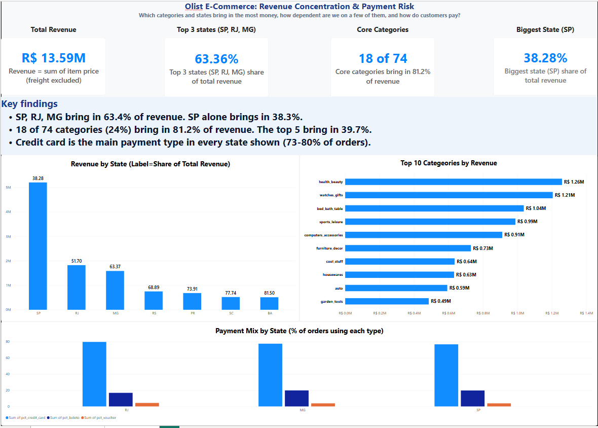
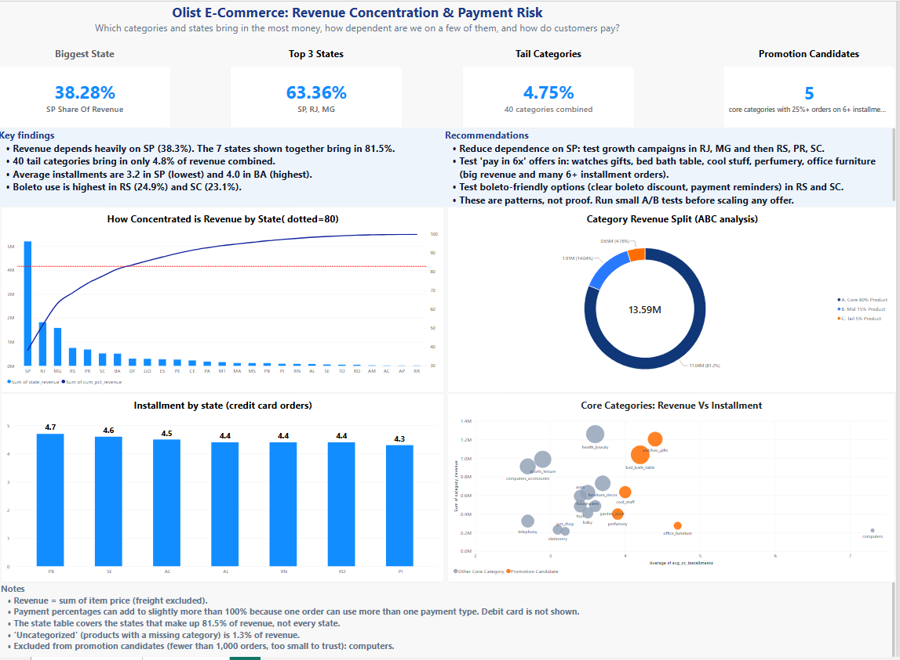

# Olist E-Commerce: Revenue Concentration & Payment Risk

## Business question
> Which product categories and customer states bring in the most money, and how much of total revenue comes from just the top few? Do customers in the top areas pay differently (credit card vs. boleto, and number of installments)?

## Key findings
- **Revenue is concentrated in a few states.** SP, RJ and MG bring in **63.4%** of revenue, and SP alone brings in **38.3%**. Just **7 of 27 states** bring in 81.5%.
- **Revenue is concentrated in a few categories.** **18 of 74** categories (24%) bring in **81.2%** of revenue, and the top 5 bring in 39.7%. The 40 smallest categories together bring in only **4.8%**.
- **Credit card is the main payment type** in every state (69-84% of orders). Among the 7 core states, boleto use is highest in RS (24.9%) and SC (23.1%).
- **Installment use varies.** In the core states, average credit-card installments run from 3.2 (SP) to 4.0 (BA). The highest averages are in PB, SE and AC (4.5-4.7), but those three states bring in only 1.4% of revenue together.
- **By category,** watches_gifts (32.4%) and bed_bath_table (29.4%) have the largest share of orders paid in 6+ installments among the top-revenue categories.

## Recommendations
1. **Reduce dependence on SP:** test growth campaigns in RJ and MG, then RS, PR and SC.
2. **Test "pay in 6x" offers** in watches_gifts, bed_bath_table, cool_stuff, perfumery and office_furniture (big revenue and many 6+ installment orders).
3. **Test boleto-friendly options** (a clear boleto discount, payment reminders) in RS and SC.

These are patterns, not proof. Run small A/B tests before scaling any offer.

## Dashboards
The same analysis is built twice from the same two CSV files:

- **Power BI** (screenshots below)
- **Dash**, an interactive web app: `olist_dashboard.py`




## Method
- **Data:** Olist Brazilian E-Commerce dataset (Kaggle): customers, orders, order_items, order_payments, products, product_category.
- **Orders included:** all orders that have at least one item (98,666 orders), whatever their status (delivered, canceled, shipped and so on). Orders are **not** filtered to delivered only.
- **Revenue:** sum of item `price`, freight excluded: **R$ 13,591,644**.
- **Related project:** the [customer retention project](https://github.com/leodera/olist-revenue-retention) keeps delivered orders only (96,478 orders) and reports R$ 13,221,498. The R$ 370,146 gap is the 2,188 orders that were not delivered. Both projects add up item prices the same way, and only the set of orders differs.
- **SQL:** two summary tables, one per state and one per category, saved as `dashboard_state.csv` (27 states) and `dashboard_products.csv` (74 categories).
- **ABC tiers:** states and categories are ranked by revenue. A = the first ~80% of cumulative revenue (core), B = the next ~15% (mid), C = the last ~5% (tail).
- **Promotion candidates:** core categories with at least 1,000 orders and at least 25% of orders on 6+ credit-card installments.
- **Consistency check:** the state and category files both add up to R$ 13.59M.

## Limitations
- Revenue includes orders that were later canceled or never delivered (about 2.7% of revenue), so the figures are slightly higher than realized revenue. Shares such as SP's 38.3% change very little either way.
- Payment percentages can add to slightly more than 100%, because one order can use more than one payment type. Debit card is not shown.
- "Uncategorized" (products with a missing category) is 1.3% of revenue.
- Very small categories and states have few orders, so their percentages are unreliable. For example, `computers` has only 181 orders, so it is excluded from promotion candidates.
- The data shows how customers pay. It does not show whether an offer would change their behavior.

## Project structure
```
dash_project/
├── olist_dashboard.py          # Dash app
├── requirements.txt
├── sql_queries/                # earlier versions of the queries (they filter to delivered orders; the dashboard CSVs were exported without that filter)
├── csv_files_from_queries/     # dashboard_state.csv, dashboard_products.csv
└── dashboards/                 # Power BI screenshots
```

## Run the Dash app
```bash
pip install -r requirements.txt
python olist_dashboard.py
```
Then open http://127.0.0.1:8050

## Tools
SQL, Python (pandas, Plotly, Dash), Power BI
